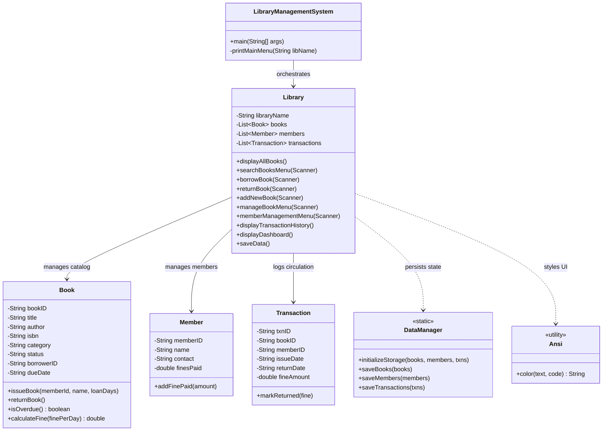
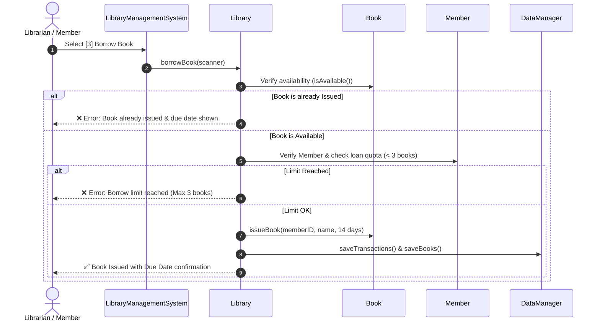

<div align="center">

# 📚 ITUM Library Management System
**A Modern, Persistent, Console-Based Library Circulation & Catalog Management Engine**

[](https://www.oracle.com/java/)
[](https://github.com/)
[-brightgreen?style=for-the-badge)](https://github.com/)
[](https://github.com/)
[](LICENSE)

<br/>

*Designed with pure Java Object-Oriented Principles, rich ANSI terminal styling, automatic file persistence, loan limit tracking, and fine calculation for overdue returns.*

</div>

---

## 📑 Table of Contents

- [Overview](#-overview)
- [Key Features](#-key-features)
- [Terminal Preview](#-terminal-preview)
- [System Architecture](#-system-architecture)
- [Circulation Workflow](#-circulation-workflow)
- [Project Structure](#-project-structure)
- [Data Storage Schema](#-data-storage-schema)
- [Getting Started](#-getting-started)
  - [Prerequisites](#prerequisites)
  - [Running the Application](#running-the-application)
- [Configuration Constants](#-configuration-constants)
- [Future Roadmap](#-future-roadmap)
- [Contributing](#-contributing)
- [Author & Acknowledgments](#-author--acknowledgments)

---

## 💡 Overview

The **ITUM Library Management System** is an enterprise-grade terminal application built to streamline library circulation, inventory tracking, member accounts, and lending audit trails.

Unlike standard textbook examples that lose data on exit, this system features **autonomous file persistence**, **intelligent fine calculation for late returns**, **per-member borrow limits**, **multi-field search**, and an **interactive analytics dashboard**.

---

## ✨ Key Features

| Category | Capability | Description |
| :--- | :--- | :--- |
| **💾 Persistence** | Zero-Setup File Storage | Automatically persists records in pipe-delimited files (`data/books.txt`, `data/members.txt`, `data/transactions.txt`). Seeds default catalog on first run. |
| **📖 Cataloging** | Dynamic Table View | Formatted Unicode/ASCII tables with auto-truncation to prevent border misalignment. |
| **🔍 Search & Filter** | Multi-Criteria Lookup | Search across Title, Author, ISBN, or Book ID; filter by Category or Circulation Status (Available vs. Issued). |
| **👥 Member Management** | Borrower Tracking & Quotas | Member registry with contact info, total fines paid, and an enforceable quota of **max 3 concurrent loans**. |
| **⏰ Circulation & Fines** | Overdue Automation | 14-day default loan period. Automatically calculates late fines at **Rs. 20.00 / day** with settlement prompts on return. |
| **📜 Audit Logs** | Transaction Receipts | Every borrow and return generates an immutable audit record with timestamps (`TXN1001`, `TXN1002`, ...). |
| **📊 Dashboard** | Operational Analytics | Real-time overview of catalog availability, issued counts, registered members, total collected fines, and high-priority overdue alerts. |
| **🎨 User Experience** | ANSI Terminal Styling | Curated color-coded statuses (🟢 Available, 🟡 Issued, 🔴 Overdue), styled headers, and safe input handling against EOF/crashes. |

---

## 🖥️ Terminal Preview

```text
==================================================================================
          🏛️  WELCOME TO ITUM LIBRARY MANAGEMENT SYSTEM          
==================================================================================
  [1] Browse & Display All Books       (Table view with categories & status)
  [2] Search & Filter Books            (Search by Title, Author, Category, Status)
  [3] Borrow a Book                    (Member validation & loan limit check)
  [4] Return a Book                    (Overdue tracking & late fine calculation)
  [5] Add New Book                     (Add new book to catalog)
  [6] Edit / Remove a Book             (Update details or delete books)
  [7] Member Management                (Register, view members & active loans)
  [8] Transaction History              (Audit log of borrows, returns & fines)
  [9] Statistics Dashboard             (Overview, overdue alert report & metrics)
  [0] Save & Exit Application
==================================================================================
Enter your choice: 1

📚 --- ALL BOOKS IN CATALOG ---
+-------+----------------------------------+-----------------------+----------------------+---------------+------------+--------------+
| ID    | Title                            | Author                | Category             | ISBN          | Status     | Due Date     |
+-------+----------------------------------+-----------------------+----------------------+---------------+------------+--------------+
| 101   | To Kill a Mockingbird            | Harper Lee            | Classic Fiction      | 0060935464    | Available  | -            |
| 102   | 1984                             | George Orwell         | Dystopian            | 0451524934    | Available  | -            |
| 111   | Madoldoowa                       | Martin Wickramasinghe | Sri Lankan Literature| 2002039293    | Available  | -            |
| 113   | Clean Code: Handbook of Agile... | Robert C. Martin      | Technology / Software| 0132350882    | Available  | -            |
+-------+----------------------------------+-----------------------+----------------------+---------------+------------+--------------+
  Total count: 14 book(s)
```

---

## 📐 System Architecture

The project adheres to clean separation of concerns using Object-Oriented Design (OOD):



---

## 🔄 Circulation Workflow



---

## 📂 Project Structure

```
Library_Management_System_JAVA/
├── LibraryManagementSystem.java     # Monolithic source file (pure portability)
│   ├── Ansi                         # Terminal ANSI styling utility
│   ├── Book                         # Book entity with loan & overdue logic
│   ├── Member                       # Member profile & fine tracking
│   ├── Transaction                  # Circulation audit record
│   ├── DataManager                  # File I/O & automatic data seeding
│   ├── Library                      # Core business logic & dashboard
│   └── LibraryManagementSystem      # CLI entrypoint & interactive event loop
├── data/                            # Persistent text storage (auto-created)
│   ├── books.txt                    # Delimited book catalog records
│   ├── members.txt                  # Delimited member directory
│   └── transactions.txt             # Historical borrow/return ledger
├── LMS JAVA.iml                     # IntelliJ IDEA project configuration
└── README.md                        # Documentation
```

---

## 💾 Data Storage Schema

Files are persisted under the `./data` directory with pipe (`|`) delimitation:

### 1. `books.txt`
```text
bookID|title|author|isbn|category|status|borrowerID|borrowerName|issueDate|dueDate
```
*Example:*
```text
101|To Kill a Mockingbird|Harper Lee|0060935464|Classic Fiction|Available||||
102|1984|George Orwell|0451524934|Dystopian|Issued|M101|Umindu Dinal|2026-10-23 14:00:00|2026-11-06
```

### 2. `members.txt`
```text
memberID|fullName|contactNumber|totalFinesPaid
```
*Example:*
```text
M101|Umindu Dinal|071-2345678|0.00
M102|Kasun Perera|077-9876543|40.00
```

### 3. `transactions.txt`
```text
txnID|bookID|bookTitle|memberID|memberName|issueDate|dueDate|returnDate|fineAmount|status
```
*Example:*
```text
TXN1001|102|1984|M101|Umindu Dinal|2026-10-23 14:00:00|2026-11-06||0.00|Active
```

---

## 🚀 Getting Started

### Prerequisites

Ensure you have a modern **Java Development Kit (JDK 11 or higher)** installed. The system has been validated on **JDK 17 LTS, JDK 21 LTS, and JDK 25**.

Check your Java installation:
```bash
java -version
javac -version
```

### Running the Application

Clone the repository and enter the directory:
```bash
git clone https://github.com/umindudinal/Library_Management_System_JAVA.git
cd Library_Management_System_JAVA
```

#### Option A: Direct Run (Fastest — Java 11+)
No compilation step needed:
```bash
java LibraryManagementSystem.java
```

#### Option B: Standard Compile and Run
```bash
# 1. Compile
javac LibraryManagementSystem.java

# 2. Run
java LibraryManagementSystem
```

#### Option C: In an IDE (VS Code / IntelliJ IDEA / Eclipse)
1. Open the project folder in your IDE.
2. Navigate to [LibraryManagementSystem.java](file:///c:/Users/23IT0470/Desktop/Library_Management_System_JAVA/LibraryManagementSystem.java).
3. Click the **Run** button (▶) directly above `public static void main(String[] args)`.

---

## ⚙️ Configuration Constants

Operational thresholds are easily adjusted at the top of the [Library](file:///c:/Users/23IT0470/Desktop/Library_Management_System_JAVA/LibraryManagementSystem.java#L409) class:

```java
private final double FINE_PER_DAY     = 20.0; // Rs. 20.00 per overdue day
private final int    LOAN_PERIOD_DAYS = 14;   // 2 weeks loan period
private final int    MAX_BORROW_LIMIT = 3;    // Maximum concurrent books per member
```

---

## 🗺️ Future Roadmap

- [ ] **GUI Interface**: Desktop frontend using JavaFX or Swing.
- [ ] **Database Integration**: Switch storage engine to SQLite / PostgreSQL via JDBC.
- [ ] **Barcode / QR Code Support**: Fast book check-in and check-out via camera or scanner.
- [ ] **Email Notifications**: Automated due date reminder emails via JavaMail API.
- [ ] **REST API**: Spring Boot backend exposing endpoints for mobile & web clients.

---

## 🤝 Contributing

Contributions, issues, and feature requests are welcome!
1. Fork the Project.
2. Create your Feature Branch (`git checkout -b feature/AmazingFeature`).
3. Commit your Changes (`git commit -m 'Add some AmazingFeature'`).
4. Push to the Branch (`git push origin feature/AmazingFeature`).
5. Open a Pull Request.

---

## 👨‍💻 Author & Acknowledgments

- **Author**: [Umindu Dinal](https://github.com/umindudinal)
- **Institution**: Institute of Technology, University of Moratuwa (ITUM)
- **Project Repository**: [Library_Management_System_JAVA](https://github.com/umindudinal/Library_Management_System_JAVA)

---

<div align="center">
  <sub>Built with ❤️ and Java SE. Star ⭐ the repository if you found this project helpful!</sub>
</div>